# Fresh File Explorer

**Git-aware navigation for VS Code:** a tree of recent changes, a branch-relative blame heatmap, branch compare, pickaxe diff search, and a resurrect-deleted-files button.

GitLens companion or lean alternative. No telemetry. No AI buttons.

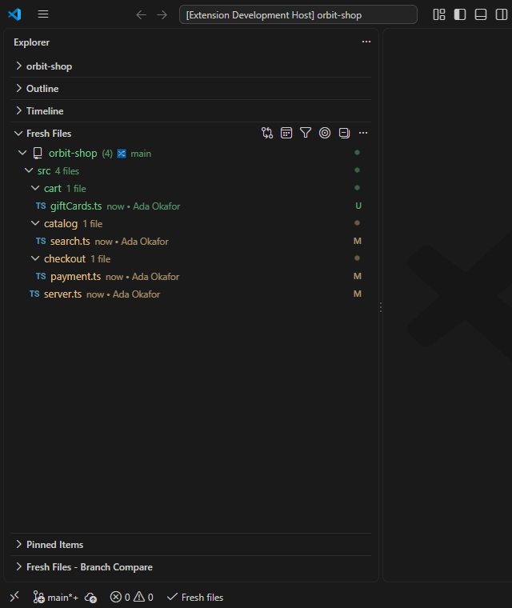

**Testimonials**

> *"I especially like the heatmap, makes it very easy to immediately figure out what is actively being worked on, even in the regular file explorer view."* — HN user helle253
>

> *"Nice and innovative which I love to see on an IDE feature, innovation. Boom."* - HN user cbxyp

> *Within two days of my HN post, [Matt Sephton](https://github.com/gingerbeardman) built a [port to the Nova editor](https://extensions.panic.com/extensions/com.gingerbeardman/com.gingerbeardman.FreshFiles/) ([blog post](https://blog.gingerbeardman.com/2026/02/24/fresh-files-extension-for-nova-editor/)).*

## What it answers

| You ask | It does |
|---|---|
| What's been touched recently? | [Time-window file tree](#fresh-files) |
| What did *this branch* change vs main? | [Branch Compare](#branch-compare) + [blame heatmap — baseline mode](#heatmap-coloring) |
| What are my agents doing in their worktrees? | [Branch Compare auto-follow](#branch-compare) |
| Where's the file I deleted? | [Deleted files inline](#deleted-file-support) — one-click resurrect |
| When was `x` added or removed across history? | [Diff search (pickaxe)](#search--history) |
| Find `b` only in files containing `a`? | [Chained search](docs/search-and-history.md#search-in-found-files) |
| Share a permalink to this file? | [Copy Remote URL](#context-menu-actions) |
| I can't read? | [CodeStonks Charts](#codestonks) |

## Links

[Marketplace](https://marketplace.visualstudio.com/items?itemName=frehu.fresh-file-explorer) | [OpenVSX](https://open-vsx.org/extension/frehu/fresh-file-explorer) | [Github](https://github.com/FreHu/vscode-fresh-file-explorer)

## Fresh Files

The files you touched recently, as a tree: pending changes, or everything changed in the last day, week, month… of git history. A hybrid of File Explorer (which sometimes shows too much) and Source Control (which sometimes shows too little). Commit as often as you like; the overview stays.

- **Filtering** — by author, commit, AI co-authorship, pathspec or folder. Files marked generated by `.gitattributes` are labelled and can be hidden.
- **Grouping** — folder structure, flat list, author, commit, or [moon phase](#grouping-modes).
- **Quick Open** — a `Ctrl+P` limited to fresh files, with filters and a search-inside step.
- **Sync status** — ahead / behind the remote and the base branch, at the top of the tree.

Details: [docs/fresh-files.md](docs/fresh-files.md).

### Grouping Modes

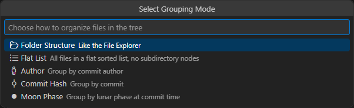

Folder structure, flat list, author and commit hash, plus moon phase.

## Branch Compare

Comprehensive comparison of branches, tags or arbitrary refs.
- multiple concurrent comparisons
- multi-repo
- manage and persist comparisons per workspace through their settings panel 

| Settings panel | Tree view |
|---|---|
| 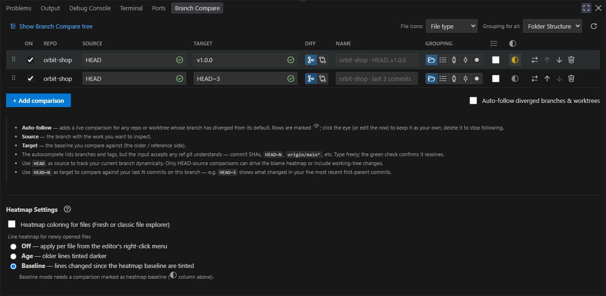 | 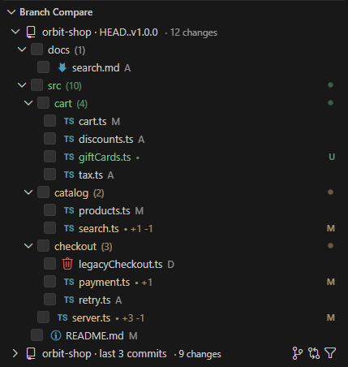 |

**Auto-follow diverged branches & worktrees** — tick it in the settings panel and comparisons appear on their own: every repo or worktree whose branch has diverged from its default branch gets a live section. Doesn't matter who is doing the work: you, or an LLM agent juggling 20 worktrees behind your back.

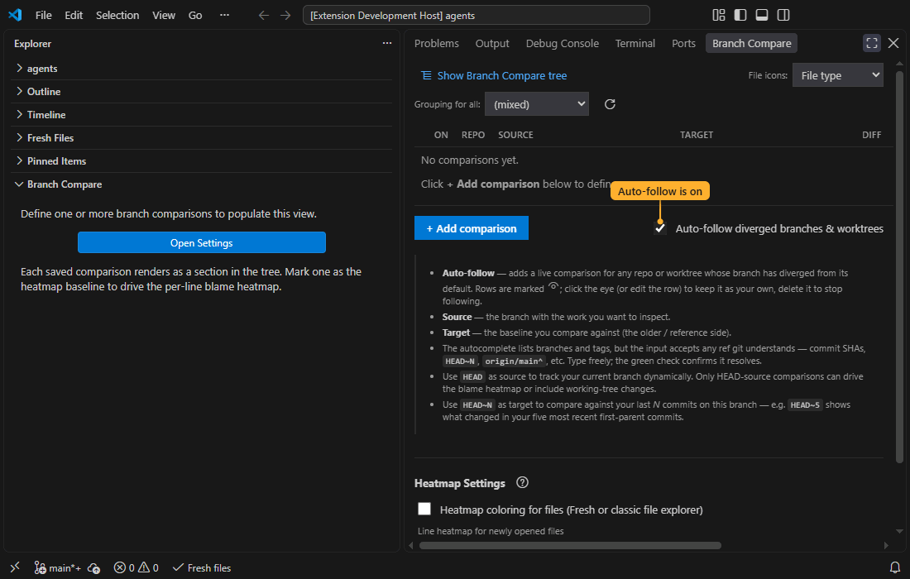

Details — refs you can compare, diff modes, external diff tools: [docs/branch-compare.md](docs/branch-compare.md).

## Heatmap Coloring

Heatmaps for different purposes.

**File heatmap** — colors files in the tree by recency. Brighter = more recent. Answers *"which files have been touched lately?"* at a glance, when scrolling around.

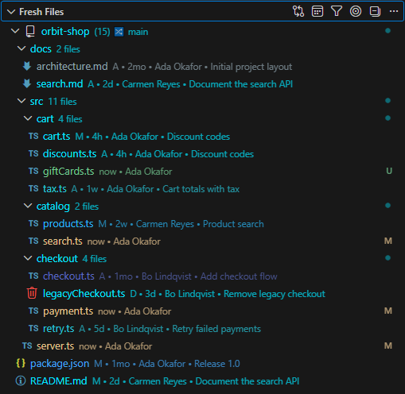

**Blame heatmap** — paints individual lines inside the editor. Two modes:

- **Age** - line color reflects recency of the last commit on that line. Fresh code stands out, ancient code fades.
- **Baseline** - colors *only* lines committed since vs a chosen baseline. Pre-baseline lines stay uncolored. Added lines get a distinct green palette. Pure deletions surface as red gutter badges with **restore from baseline** / **copy baseline lines** actions.

> **"But didn't you just reinvent a diff?"**
> 
> Sort of. You open a diff when you already at least half-know you're looking for a difference. The heatmap is ambient - it shows up while you're in the file for any other reason. It surfaces things you weren't asking about, but doesn't get in your way.

Full details - all the knobs, bucketing, theming, performance notes: [docs/heatmap.md](docs/heatmap.md).

## Restoring Deleted Files

Deleted files appear in the tree where they used to be, ready for necromancy.

- **Exhume**: Click the file to open it in a temp file
- **Resurrect**: Restores the file to its original location `(git restore)`

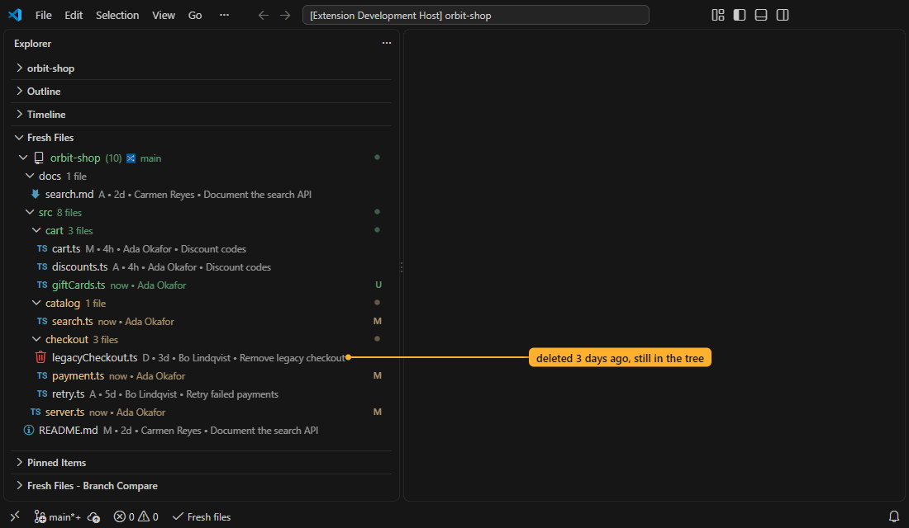

## Search & History

| Feature | Question it answers | Searches |
|---|---|---|
| **Diff Search** | When was `x` ever added or removed? | Commits whose diff adds or removes a line matching `x` `(git log -G, pickaxe)`. Surfaces a not widely known but extremely useful git feature. |
| **Line / Function History** | What's the full history of this function or code block? | Git log for a specific line range or function name `(log -L)` |
| **File History** | What's the full history of this file? | Git log for an entire file, following renames, with a line-changes chart |
| **Search in Fresh Files** | Where is `x` in my current work? | File contents, on disk, scoped to fresh files |
| **Search in Found Files** | I want to find `y` in all files that contain `x`. Then find `z` only in those. | File contents, on disk, chained from a previous search |

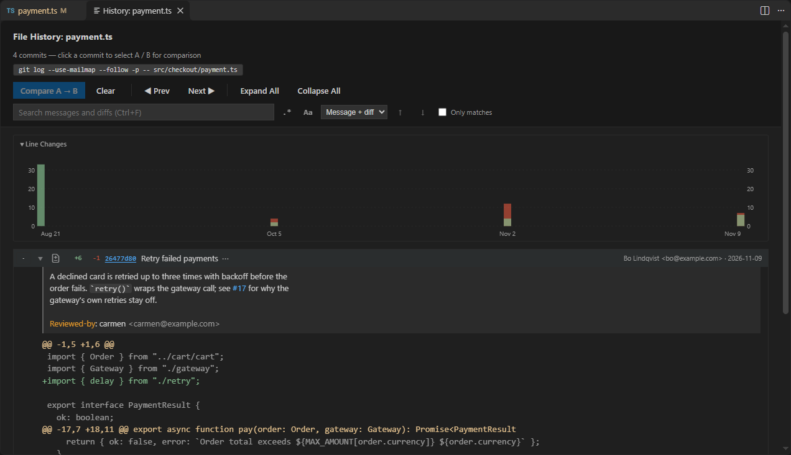

Diff Search is in the editor's right-click menu (**Search Diffs for Selection**), or in its own panel with regex, path filters and a time limit. Details for all five: [docs/search-and-history.md](docs/search-and-history.md).

## Multi-Repository Support

Works across:

- **Folders containing multiple repos in subfolders** — the "monorepo of repos" layout
- **Multi-root workspaces**
- **Worktrees** — each worktree shows its own pending changes and history. New and removed worktrees, and commits in them, show up live even when VS Code's git doesn't open them (`git.detectWorktrees` is off by default).
- **Submodules** — treated as nested repos

Repos listed in `git.ignoredRepositories` are left out.

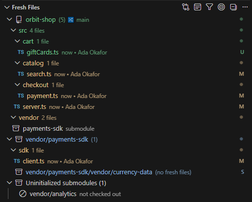

## Pinned section

Adds a special "pinned items" view. This is for files you want to keep handy independent of whatever the fresh file explorer is showing you. You can pin items with drag&drop or through the right click menu in the file explorer. 

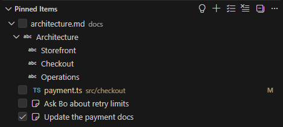

- Pin a non-fresh file you need to pay attention to, like a diagram or readme
- Pin that critical file you've had on your desktop for the last 6 years. It does not have to be from your workspace.
- Pin a deleted file
- Pin a folder. Clicking it reveals it in the Explorer, or in your OS file manager when it's outside the workspace.
- Pin a search editor (must be saved as a file)
- Create short notes and use it as a todo list. They can be reordered and marked as complete.
- Pin a Markdown (`.md`, `.markdown`, `.mdx`, Quarto `.qmd`, R Markdown `.Rmd`), Org-mode (`.org`) or AsciiDoc (`.adoc`, `.asciidoc`) file and its headings show up as children, kept in sync as you edit. Org-mode TODO keywords show next to their heading. Click a heading to jump to it. `freshFileExplorer.pinned.headingDepth` sets the deepest heading shown, `freshFileExplorer.pinned.headingExpandDepth` how many levels start expanded.
- Pin your sensitive API keys as notes. All the pros do it.

The pins are stored per workspace.

**Find Files Modified Together [experimental]** (right-click a file, or the Pinned Items toolbar) suggests files that usually change together with what you're working on, based on history, including across repos linked by ticket IDs in commit messages (`freshFileExplorer.cochange.*`). Suggestions show up here with the reason; keep them as pins or clear them.

## Context Menu Actions

Routine file operations (copy / cut / paste / rename / create / delete, and path copying) work like File Explorer, with the standard keybindings. Beyond that:

- **Open / Open to Side** — opens either the file or its diff. A toolbar button switches what a click does; Branch Compare has its own (defaulting to diffs).
- **Open in Default App** — opens the file the way a double-click in your OS would, e.g. an `.xlsx` in Excel. Also added to VS Code's own Explorer and editor tab menus, which lack it.
- **Copy Remote URL** — a browser link for the file at the current branch. Supports GitHub, GitLab, Bitbucket and Azure DevOps.
- **Copy Subtree Structure** — the directory tree as text, for chat, docs and LLM prompts. When invoked from Fresh Files, it lists only those.
- **Compare Selected** (`Ctrl+Alt+C`) — diff any two files; with 3+, all permutations or one vs. the rest.
- **Reveal Active File** — jump from the editor to its node in Fresh Files (`freshFileExplorer.autoReveal` does it on every tab switch).
- **Reveal in Explorer / File Explorer / Source Control** — bridges back to the standard views.
- **Rename** (`F2`) — `git mv` by default, so the rename is staged (`freshFileExplorer.autoStageRename`).
- **Discard Changes** (pending files) 
- **Resurrect** (deleted files).
- **Pin** 
- **Find Files Modified Together** — see the [Pinned section](#pinned-section).

## CodeStonks

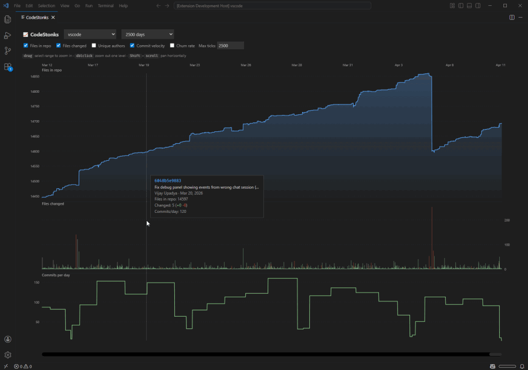

How your repository evolved over time, as a chart: files, churn, commit velocity, author concentration. Open it from the `...` menu in the Fresh Files view or the command palette (`Fresh File Explorer: CodeStonks`).

You can keep this open if you want your boss to think you are daytrading when you're really vibecoding.

Metrics, zooming and repo comparison: [docs/codestonks.md](docs/codestonks.md) (also behind the help button inside the view).

## Use Cases

### "I just cloned a large repo and don't know where to start"

You joined a new company and the codebase has thousands of files. Most haven't been touched in the last 75 years. But the file explorer shows everything, making it overwhelming to find where active development is happening.

| Approach                | How it works                                                                      | Friction                                                     |
| ----------------------- | --------------------------------------------------------------------------------- | ------------------------------------------------------------ |
| **Default VS Code**     | Browse folders manually, maybe search for recent commits in Source Control        | High - requires mental context switching, no visual overview |
| **GitLens**             | Use "Commits" view to see recent commits, then navigate to files from there       | Medium - commit-centric view, extra clicks to open files     |
| [Fresh File Explorer](#fresh-files) | Open the Fresh Files panel, see all files modified in last 30 days as a file tree | Low - immediate visual overview, familiar tree navigation    |

---

### "I swear this file was here at some point"

You remember a file existed, but it's not there. Was it renamed? Moved? Did you misremember the path? Have you been drinking again? It's someone else's fault _this time_, but you're questioning your own sanity.

| Approach                | How it works                                                         | Friction                                        |
| ----------------------- | -------------------------------------------------------------------- | ----------------------------------------------- |
| **Default VS Code**     | Search for the filename, find nothing, assume you're wrong           | High - no hint that deletion occurred           |
| **GitLens**             | Would need to think "maybe it was deleted" and search commit history | High - requires the right mental model          |
| [Fresh File Explorer](#deleted-file-support) | Deleted files appear right where they used to be                     | Zero - it's still there, just marked as deleted |

---

### "I accidentally deleted some files and need them back"

**Pain Point:** You deleted files and realize you need them. They're committed to git but you wish it was easier to get them back.

| Approach                | How it works                                                     | Friction                                                  |
| ----------------------- | ---------------------------------------------------------------- | --------------------------------------------------------- |
| **Default VS Code**     | `git log --diff-filter=D`, then `git checkout <hash>^ -- <path>` | High - requires git expertise                             |
| **GitLens**             | Find the deletion commit, view file at revision, copy content    | Medium - several steps                                    |
| [Fresh File Explorer](#deleted-file-support) | Deleted files are there, right-click → "Resurrect"               | Low - one-click restore. Works on multiple files at once. |

---

### "I made a commit and now I've lost track of what I was working on"

You make a commit but now your "pending changes" view is empty. You've lost the mental map of which files you were touching. This actually discourages small, frequent commits because you want to keep that overview.

| Approach                | How it works                                                                                 | Friction                                                                                                        |
| ----------------------- | -------------------------------------------------------------------------------------------- | --------------------------------------------------------------------------------------------------------------- |
| **Default VS Code**     | Pending changes disappear after commit, must remember or check git log                       | High - punishes good commit practices                                                                           |
| **GitLens**             | Can view recent commits, but context switch required                                         | Medium - the information is there, but in a different place, and you can only have so many views open at a time |
| [Fresh File Explorer](#fresh-files) | Set time window to "Last 7 days" - your committed files still appear, organized by directory | Low - commit freely, overview persists                                                                          |

### "I was using Fresh File Explorer and it was going great, but then someone reformatted the entire codebase and now all the files are fresh"

**Pain Point:** A large automated change (formatting, linting, dependency updates) pollutes your view of what actually changed.

| Approach                | How it works                                                                                           | Friction                                    |
| ----------------------- | ------------------------------------------------------------------------------------------------------ | ------------------------------------------- |
| **Default VS Code**     | No built-in way to filter by author                                                                    | High - must use terminal commands           |
| **GitLens**             | Can filter by author in various views                                                                  | Medium - need to know where to look         |
| [Fresh File Explorer](#filtering) | Filter out the person doing the formatting, or (it was _you_, wasn't it?) the commit where it was done | Low - visual multi-select, instant feedback |

---

### "Cool extension but I was looking for a todo list app"

**Pain Point:** There just aren't enough todo list apps out there.

| Approach  | How it works  | Friction  |
| --------------- | ----------------- | ---------------- |
| **Default VS Code**     | Is not a todo list | High - must vibe-code your own todo list |
| **GitLens**             | Is probably not a todo list | Medium - I don't know, maybe it even has a todo list  |
| [Fresh File Explorer](#pinned-section) | Is *also* a todo list | Low - Can't miss it |
---

### "Cool extension but can it group my files by moon phase"

[Yes.](#grouping-modes) It might even be the *only* piece of software that does that.

## Comparison with GitLens

Fresh File Explorer is a focused **companion** to GitLens, not a replacement. It does the recent-changes navigation you reach for most of the day, and leaves the full SCM management to more comprehensive tools.

> A time-window view isn't *better* than a commit-centric one — but it's often handier. Your brain doesn't have git installed, but it usually knows what day it is.

| Feature | Fresh File Explorer | GitLens |
| --- | --- | --- |
| **Focus** | Recent-file navigation | Comprehensive git integration |
| **Learning curve** | Minimal | Significant |
| **Time-window view** (files from the last *N* days) | ✅ Built in | ❌ Reference-based only (branch / tag / commit) |
| **Multi-repo unified view** | ✅ Automatic across the workspace | ⚠️ Manual per-repo comparisons |
| **Deleted file restore** | ✅ One-click, shown inline in the tree | ✅ Via commit history (more steps) |
| **Blame** | ✅ Ambient heatmap — line-recency or branch-baseline coloring | ✅ Inline annotations + hover detail (richer) |
| **Line / function history** | ✅ Incl. pickaxe diff search | ✅ Detailed |
| **Price** | Free (will always accept your money) | Free (will sometimes demand your money) |

## Extension Settings

Look under `freshFileExplorer.` to see all configurable settings.

## Performance

Unlike File Explorer, which just needs the files on your disk, Fresh File Explorer must load part of your git history to work. This is done in one streaming pass on startup, after which the results are cached. For the view to become usable, you only wait as long as your configured time window takes to load. The remaining time windows keep loading in the background, so that by the time you need them, they are ready. Reloads happen when switching branches or syncing changes.

Not looking 5 years back in a large repo will go a long way in terms of performance. But you can. Also avoid configuring long time windows you never need - adds pointless startup overhead in the background.

If you mainly use the other features, set `freshFileExplorer.freshFileLoading` to `"manual"`: the history scan then waits for a Refresh (or a feature that needs it), while Branch Compare, the blame heatmap and the rest keep working.

## Security

I got some feedback around what is essentially an inherent problem with the trustworthiness of extensions in general. It's a valid concern and not one I can solve. 

All I can give you is some assurances:

- Fresh File Explorer contains no telemetry and does not make any web requests. It doesn't ask AI to do anything.
- The code is right here for you to audit. There are zero runtime dependencies.
- If you're worried about me getting hacked and malware being pushed through an update, you can disable automatic updates for any extension. You will lose out on new bugs and features, but you will always have the code you at some point chose to trust.
- The marketplace PATs are not stored on my machine. Github actions handle publishing to both marketplaces (vscode and openVSX). I don't publish to any other marketplace.

Potentially dangerous features: none, really. But for completeness' sake:
- Destructive operations: [discard pending changes](./src/commands/discardChangesCommand.ts) and [delete files](./src/commands/basicCommands.ts) (moved to trash). Both work on files you yourself selected and give you a warning.
- Rename uses `git mv` by default, or a plain filesystem rename if `freshFileExplorer.autoStageRename` is disabled. It will not overwrite existing files.
- It can create files if you choose to (via create or resurrect), but will never overwrite existing ones.
- When viewing deleted files (referred to as `exhume`), a copy is saved as a temp file in `%TEMP%\fresh-file-explorer` or `/tmp/fresh-file-explorer`. This is only for files you try to open. If you really want something gone, you'll have to delete it from there.
- Git calls are safe from shell injection and static analysis enforces it.
  
As well as some warnings:

- Don't install random extensions from the internet just because they look cool. They can do pretty much whatever on your computer. Except for mine, mine's good.
- A person who doesn't already know this is unlikely to bother reading this documentation.

## Contributing

If you find a bug or have an idea for a faster horse, open an issue.

For bug reports, it is extremely helpful if the problem is reproducible on a public repository.
