# Fresh File Explorer

**Git-aware navigation for VS Code:** a tree of recent changes, a branch-relative blame heatmap, branch compare, pickaxe diff search, and a resurrect-deleted-files button.

GitLens companion or lean alternative. No telemetry. No AI buttons.

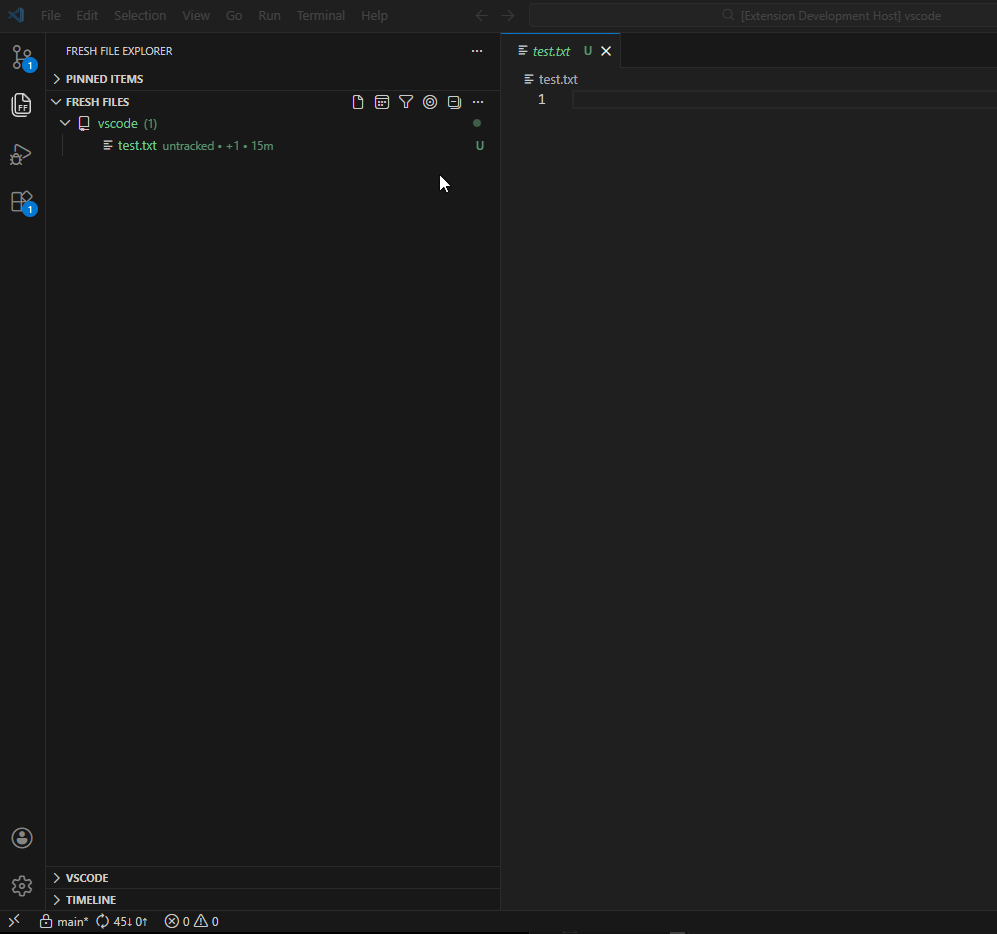

**Testimonials**

> *"I especially like the heatmap, makes it very easy to immediately figure out what is actively being worked on, even in the regular file explorer view."* — HN user helle253
>

> *"Nice and innovative which I love to see on an IDE feature, innovation. Boom."* - HN user cbxyp

> *Two days within my HN post, [Matt Sephton](https://github.com/gingerbeardman) built a [port to the Nova editor](https://extensions.panic.com/extensions/com.gingerbeardman/com.gingerbeardman.FreshFiles/) ([blog post](https://blog.gingerbeardman.com/2026/02/24/fresh-files-extension-for-nova-editor/)).*

## What it answers

| You ask | It does |
|---|---|
| What's been touched recently? | [Time-window file tree](#time-window-based-file-explorer) |
| What did *this branch* actually change? | [Blame heatmap — baseline mode](#heatmap-coloring) + Branch Compare |
| Where's the file I deleted? | [Deleted files inline](#deleted-file-support) — one-click resurrect |
| When was `x` added or removed across history? | [Diff search (pickaxe)](#diff-search-pickaxe) |
| Find `b` only in files containing `a`? | [Chained search](#search-in-found-files) |
| Share a permalink to this file? | [Copy Remote URL](#context-menu-actions) |
| I can't read? | [CodeStonks Charts](#codestonks) |

## Features

### Time Window based File Explorer

Switch between viewing pending changes or files last modified in configurable time periods (`freshFileExplorer.timeWindows`). The view is a hybrid of File Explorer (which sometimes shows too much) and Source Control (which sometimes shows too little). It honors your `files.exclude` (`freshFileExplorer.respectFilesExclude`).

### Deleted File Support

Deleted files appear in the tree where they used to be, ready for necromancy.

- **Exhume**: Click the file to open a copy of its last version in a temp file
- **Resurrect**: Restores the file to its original location `(git restore)`
  
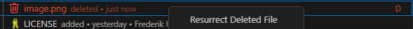

### Heatmap Coloring

Heatmaps for different scales.

**File heatmap** — colors files in the tree (and File Explorer) by recency. Brighter = more recent. Answers *"which files have been touched lately?"* at a glance, even when scrolling around in the classic File Explorer.

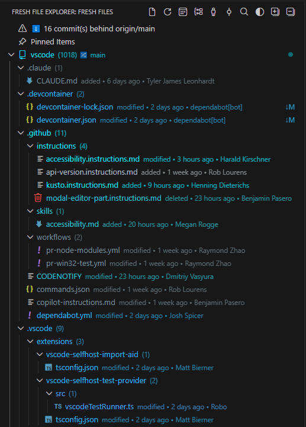

**Blame heatmap** — paints individual lines inside the editor. Two modes:

- **Age** - line color reflects recency of the last commit on that line. Other blame tools show who/when as text and stop there; this one paints the file, so fresh code stands out and old code fades.
- **Baseline** - colors *only* lines committed since you branched off a chosen baseline (branch, tag or any ref). Added lines get a distinct green palette. Pure deletions surface as red gutter badges with **restore from baseline** / **copy baseline lines** actions.

Useful for questions like:

- *"Which lines in this big function did I just change?"*
- *"What did this branch actually touch in this file vs. main?"*
- *"What got deleted since I branched off — and can I get it back?"*

> **"But didn't you just reinvent a diff?"**
> 
> Sort of. You open a diff when you already at least half-know you're looking for a difference. The heatmap is ambient - it shows up while you're in the file for any other reason. It surfaces things you weren't asking about, but doesn't get in your way.

Full details - all the knobs, bucketing, theming, performance notes: [docs/heatmap.md](docs/heatmap.md).

### Pinned section

Adds a special "pinned items" view. This is for files you want to keep handy independent of whatever the fresh file explorer is showing you. You can pin items with drag&drop or through the right click menu in the file explorer. 

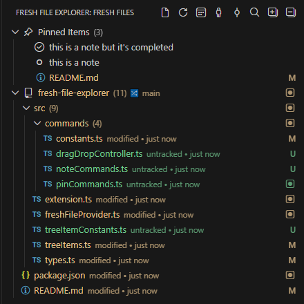

- Pin a non-fresh file you need to pay attention to, like a diagram or readme
- Pin that critical file you've had on your desktop for the last 6 years. It does not have to be from your workspace.
- Pin a deleted file
- Pin a search editor (must be saved as a file)
- Create short notes and use it as a todo list. They can be reordered and marked as complete.
- Pin a Markdown (`.md`, `.markdown`, `.mdx`, Quarto `.qmd`, R Markdown `.Rmd`), Org-mode (`.org`) or AsciiDoc (`.adoc`, `.asciidoc`) file and its headings show up as children, kept in sync as you edit. Org-mode TODO keywords show next to their heading. Click a heading to jump to it. `freshFileExplorer.pinned.headingDepth` sets the deepest heading shown, `freshFileExplorer.pinned.headingExpandDepth` how many levels start expanded.
- Pin your sensitive API keys as notes. All the pros do it.

The pins are stored per workspace.

**Find Files Modified Together** (right-click a file, or the Pinned Items toolbar) suggests files that usually change together with what you're working on, learned from history, including across repos linked by ticket IDs in commit messages (`freshFileExplorer.cochange.*`). Suggestions show up here with the reason; keep them as pins or clear them.

### Sync Status Notifications

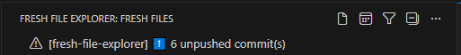
Displays info at the top of the tree view:

- When you are **behind/ahead** of the **remote** (meaning you need to push/pull)
- When you are **behind/ahead** of the **base branch** (meaning you need to merge)

Both options can be individually disabled.

### Filtering
- **Filter by Author**: Hide files from specific authors
- **Filter by Commit**: Hide files from specific commits
- **Filter by AI Co-authorship**: Show or hide changes from commits with an AI agent's `Co-authored-by` trailer (extend the recognized agents with `freshFileExplorer.aiCoAuthorEmails`)
- **Pathspec Filter**: Restrict git log to specific files or directories using [git pathspecs](https://css-tricks.com/git-pathspecs-and-how-to-use-them/) (right-click on a repo folder)
- **Scope to Folder**: Focus on a specific folder within a repo (right-click on any folder)
- **Clear filters**
- Author, commit and AI filters are temporary and reset when changing time windows
  
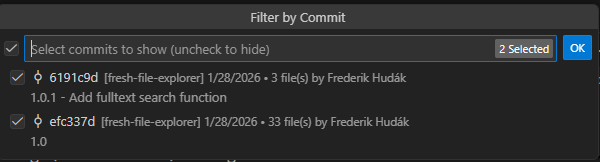

> **Note:** Filters look at each file's _most recent_ commit only, so a file last touched by a filtered author is hidden even if others changed it earlier. For deeper history analysis, use something like GitLens or learn more than 5 git commands.

### Grouping Modes

Organize your files in different ways beyond the standard folder structure:

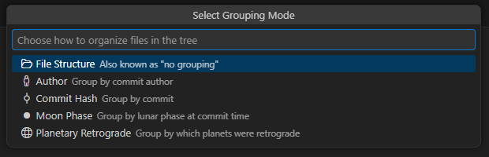

- **Folder Structure** - Traditional folder hierarchy
  
- **Flat list** - If you don't care for the nesting.
  
`freshFileExplorer.flatList.labelStyle` can customize whether the label is the full path or just the filename

- **Author** - Files grouped by who last modified them

- **Commit Hash** - One group per commit

As well as one additional grouping for advanced git blame use cases.

- **Moon Phase** (`git blame moon`)

Uneven distribution of commits during the full moon can indicate werewolves among your contributors.

> Note: This is astronomy (hard science), not astrology (garbage). If you want to know if you will have merge conflicts with the changes made by a Sagittarius, you need to look elsewhere.

**Relevant settings:**
`freshFileExplorer.defaultGroupingMode`
`freshFileExplorer.defaultSortOrder`

### Quick Open

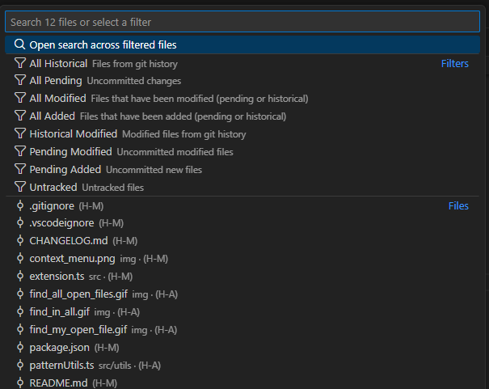

Use **"Fresh Files: Quick Open"** to get a quick pick showing files from your Fresh File Explorer view. Type to filter by filename or path, then select a file to open it. This is similar to VS Code's Ctrl+P, but filtered to only your fresh files, with some additional actions on top.

It respects the current time window and filters, adds its own filters (e.g. "pending modified"), and can start a full-text search in the listed files, so filter first, then search only those.

> Note: the quick open excludes deleted files. You'll have to access those from the tree.

### Context Menu Actions

Routine file operations (copy / cut / paste / rename / create / delete, copy path) work like in File Explorer; copy, cut, paste, Delete and F2 have the usual keybindings. Beyond that:

- **Open / Open to Side** — opens the file or its diff, per `freshFileExplorer.defaultOpenChangesMode`. A view-title button switches what a click opens; Branch Compare has its own switch (diffs by default).
- **Copy Remote URL** — generates a browser link for the file at the current branch + path. Supports GitHub, GitLab, Bitbucket, and Azure DevOps (incl. SSH-style remotes and legacy `*.visualstudio.com`). Multi-select copies one URL per line.
- **Copy Subtree Structure** — pastes the directory tree as text. From the Fresh Files tree it's **filtered to fresh files**. From the regular File Explorer it lists the full subtree, respecting `.gitignore`. Choice of absolute / relative / filename labels. Useful for chat, docs, and LLM prompts.
- **Compare Selected** (`Ctrl+Alt+C`) — diff any two files against each other. With 3+ files, choose between *all permutations* or *one vs. all others* in a multi-diff editor.
- **Reveal Active File** — jump from the current editor to its node in Fresh Files. The reverse of "reveal in explorer". Pairs with the `freshFileExplorer.autoReveal` setting which does the same automatically on tab switch.
- **Reveal in Explorer / Source Control** — bridges back to the standard views.
- **Rename** (`F2`) — uses `git mv` by default so the rename is auto-staged and properly tracked. See `freshFileExplorer.autoStageRename`.
- **Discard Changes** (pending files) / **Resurrect** (deleted files) — see [Deleted File Support](#deleted-file-support).
- **Pin** — drag-and-drop or right-click to add to the [Pinned section](#pinned-section).
- **Find Files Modified Together** — see the [Pinned section](#pinned-section).

### Multi-Repository Support

Works seamlessly across:

- **Folders containing multiple repos in subfolders** — the "monorepo of repos" layout
- **Multi-root workspaces**
- **Worktrees** — each worktree shows its own pending changes and history
- **Submodules** (experimental) — treated as nested repos

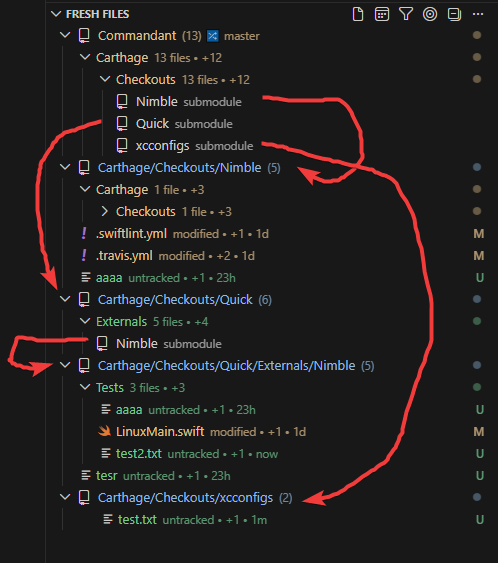

### CodeStonks

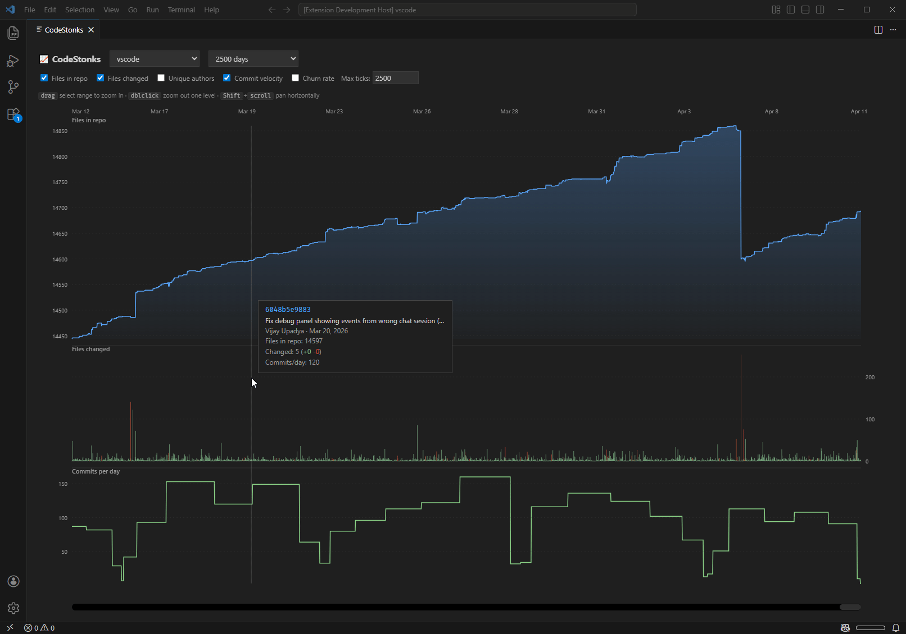

A chart view showing how your repository evolved over time. Access it from the "..." menu in the Fresh Files view or via the command palette (`Fresh File Explorer: CodeStonks`).

You can keep this open if you want your boss to think you are daytrading when you're really vibecoding.

For full details see the [CodeStonks docs](docs/codestonks.md), also opened by the help button inside the view.

**Metrics (all toggleable):**
- **Files in repo** — cumulative file count at each commit
- **Files changed** — additions and deletions per commit
- **Unique authors** *(per-commit mode)* — distinct authors in a rolling window
- **Author concentration** *(per-commit mode)* — percentage of commits by the top-N authors in a rolling window
- **Commit velocity** — commits per day, or per bucket
- **Churn rate** — files changed as a percentage of total repo size
- **Avg commit size** — rolling average of files changed per commit

**Controls:**
- **Drag** on the chart to zoom into a range
- **Double-click** to zoom back out one level (the zoom state is a stack)
- **Shift + scroll** (or trackpad horizontal swipe) to pan when there are more commits than the visible window
- **Max ticks** — configurable limit for how many commits are rendered at once before panning kicks in
- **X-axis mode** — per-commit or bucketed per day/week/month
- **Compare repos** *(day/week/month modes)* — overlay multiple repos' file count lines
- **Export SVG** — save the current chart

---

## Branch Compare

A new tree view that surfaces saved branch-to-branch comparisons. Each row is one `source..target` ref pair.

| Settings panel | Tree view |
|---|---|
| 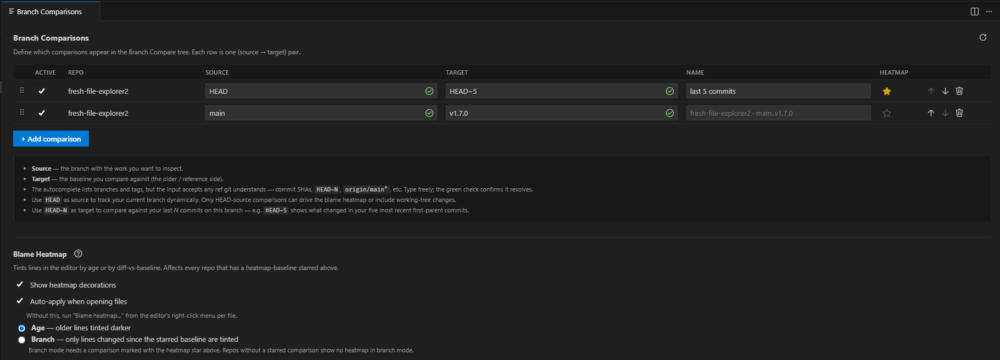 | 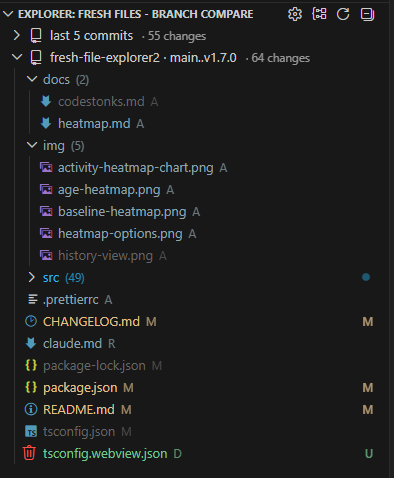 |

### How it works

- Open the Branch Comparisons panel via the gear icon in the view title.
- Add a comparison: pick a repo, type a **source** ref (the branch with the work) and a **target** ref (the baseline you compare against).
- Click any file in the tree → opens a diff between the comparison's baseline (the merge-base) and the source ref. Per comparison you can switch to a **full** diff against the target itself, hide files you've ticked as reviewed, or swap the two sides.
- File icons can show the file type or the kind of change (`freshFileExplorer.branchCompare.fileIcons`); `freshFileExplorer.branchCompare.workingTreeSide` picks which side of the diff your working tree is on.
- Right-click a deleted file → **Restore from Baseline** writes the baseline content back into the working tree as an unstaged change.
- Right-click a section or folder → **Open All Changes** queues every diff in the background.
- Right-click a file → **Open in External Diff Tool** opens it in your configured `git difftool` instead of the built-in diff editor.
- Right-click a section or folder → **Open All in External Diff Tool** does the same for every changed file at once, via `git difftool --dir-diff` — off by default (`freshFileExplorer.branchCompare.enableDirDiffTool`), see gotchas below.

### What goes in source/target

- **Branches and tags** — `main`, `origin/release-q4`, `v1.2.0`. Autocomplete lists what's available.
- **`HEAD` as source** — tracks your current branch dynamically. Only HEAD-source comparisons include working-tree changes; uncommitted files appear with a `•` marker.
- **`HEAD~N` as target** — quick "what did I change in my last N commits" view, named "last N commits". In a repo with fewer than N commits it shows all of them.
- **Any git-resolvable ref** — commit SHAs, `origin/main^`, etc. The green check next to the input confirms the ref resolves.

### Multiple comparisons

Define `vs main`, `vs release-q4`, and `vs colleague-branch` simultaneously — each gets its own section in the tree. Reorder with the up/down arrows or the drag handle in the settings panel; tree order mirrors the panel.

### Auto-follow diverged branches

Tick **Auto-follow diverged branches & worktrees** in the panel and comparisons just appear: every repo or worktree whose current branch has diverged from its default branch gets its own live section, and it disappears again when the branch goes back to the default or the worktree is removed. Work in progress shows up wherever it happens, in any number of worktrees.

These rows are marked with 👁 in the panel:
- **Delete** one (or **Stop Following** on the tree section) to stop following it until that branch changes.
- **Click the eye**, or edit the row, to keep it as your own comparison.

### Heatmap settings also live here

Mark one HEAD-source comparison per repo as the blame heatmap's baseline (the heatmap icon in its row). Baseline mode then colors lines committed since HEAD branched off that comparison's target.

The same panel holds the file heatmap toggle and the line heatmap choice for newly opened files (Off / Age / Baseline).

### Tips/gotchas

- **Empty diff** — if source is an ancestor of target, the diff is empty.
- **Merge commits** — when a `HEAD~N..HEAD` comparison sweeps in unexpected commits via merges, the tooltip surfaces both counts so the number of files in the tree makes sense.
- **Invalid refs** are hidden from the tree. The red X next to the input in the settings panel is the source of truth.
- **Duplicates** (same repo + source + target) are deduped in the tree and flagged with a warning in the settings panel.
- **External diff tool** — the single-file action works with any `diff.tool`. The multi-file (`--dir-diff`) action needs a tool that compares directories (WinMerge, Meld, Beyond Compare); with a single-file tool like `code --diff` it opens two empty folders.

---

## Search Tools

| Feature | Question it answers | Searches |
|---|---|---|
| **Search in Fresh Files** | Where is `x` in my current work? | File contents, on disk, scoped to fresh files |
| **Search in Found Files** | I want to find `y` in all files that contain `x`. Then find `z` only in those. | File contents, on disk, chained from a previous search |
| **File History** | What's the full history of this file? | Git log for an entire file, following renames |
| **Diff Search** | When was `x` ever added or removed? | Commits whose diff adds or removes a line matching `x` (`git log -G`, git's "pickaxe"). A little-known but extremely useful git feature. |
| **Line / Function History** | What's the full history of this function or code block? | Git log for a specific line range or function name `(log -L)` |

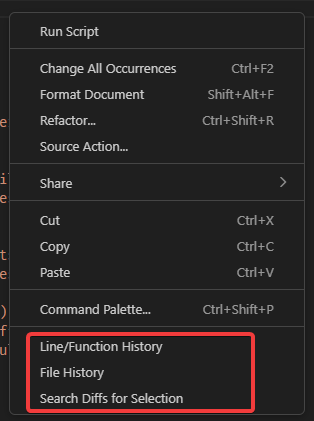
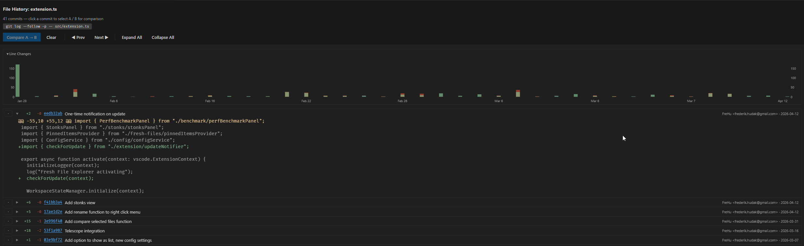

### Diff Search (pickaxe)

Answers "when was this string ever added or removed?"

Right-click a selection in the editor (**Search Diffs for Selection**), or open the **Diff Search** panel for regex, case, include / exclude paths and a time limit. Results appear in a tree grouped by repo, commit and file; click a match to open it, and filter to added or removed lines.

### Line and Function History
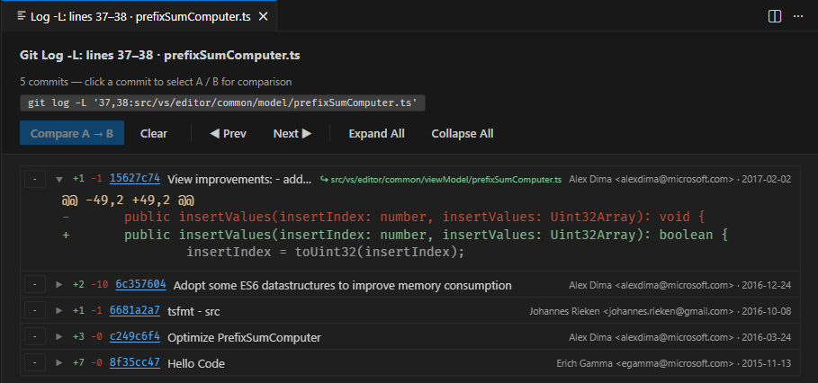
Access via right-click in the editor → **"Line/Function History"**.

Based on your selection, shows every commit that touched those lines or that function. This is a wrapper of `git log -L`.

- **Single cursor / single line** — treated as a function name (uses the word under the cursor as the funcname pattern)
- **Multi-line selection** — treated as a line range

**A / B comparison:** Mark any two commits as A and B, then click **Compare** to open a diff between those two versions of the file.

### File History

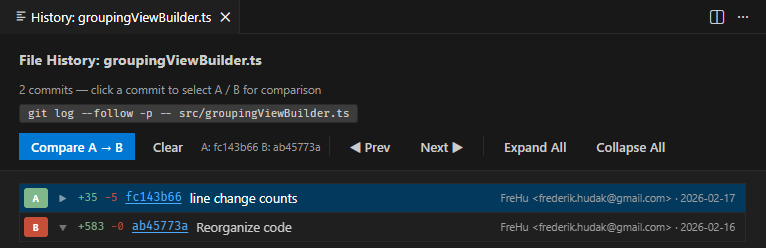

Available via:
- right-click menu in the Fresh File Explorer tree
- right-click in the editor context menu

Shows every commit that touched a file, following renames across the full repository history.

**Line-changes chart** — a stacked bar chart at the top of the panel showing how many lines were added (green) and removed (red) in each commit:
- Hover over a bar to see the commit hash, message, author, date and exact line counts
- Click a bar to jump to that commit in the timeline below
- Up to 100 commits are shown at once; pan with the scrollbar, Shift + scroll or a horizontal swipe when there are more

### Search in Fresh Files

**Search in Fresh Files** (in the Fresh Files `…` menu) opens VS Code's search with all currently visible files pre-filled in "files to include". This lets you search only within the files you're actively working on, respecting your current filters and time window. This searches file *contents* on disk. To search the tree itself, use `CTRL+ALT+F`.

You can also trigger the search from the [quick pick](#quick-open).

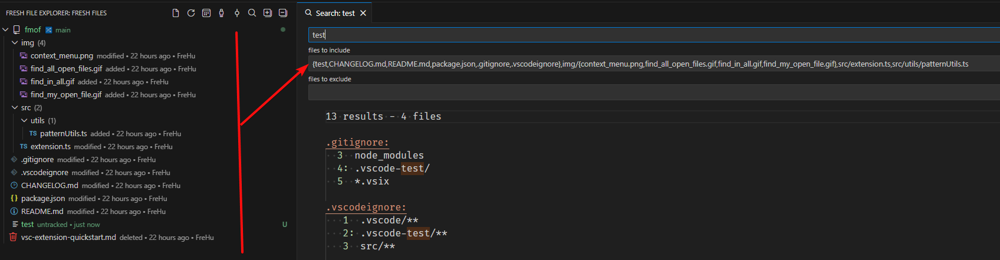

- Respects author and commit filters
- Excludes deleted files (they're not on disk to search)
- Configure whether the search opens in the view or as an editor (*default*)

#### Code Telescope quick pick
- The quick pick `(CTRL+Q, F)` can be switched to open in the Code Telescope extension [(guichina.code-telescope)](https://marketplace.visualstudio.com/items?itemName=guichina.code-telescope). It provides a better search experience but remains fully optional (I don't make code telescope or install it for you).

You need to have the extension installed and enable `freshFileExplorer.codeTelescopeIntegration` for this to work.

### Search in Found Files

**Problem:** "I want to find `b` in all files that contain `a`."

**Solution:** Search for `a`, then use this action to open another search editor scoped to the files you found with your first search, then search for `b`. This process can be chained as many times as you want.

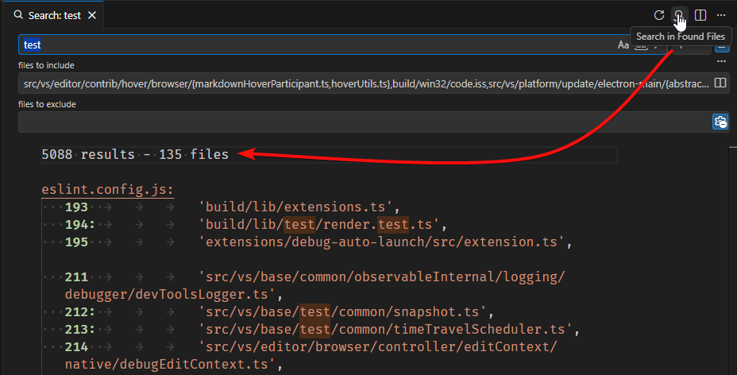

> The action is available only in search editors, not the search view. But you can easily open your search view as a search editor.

**Configuration:**
- `freshFileExplorer.openSearchInEditor`: Open searches in a Search Editor tab instead of the Search view
- `freshFileExplorer.searchPatternMaxLength`: The file list is split into batches (separate search editors) so ripgrep stays under OS command-line limits. The default (4000 chars) is conservative; raise it if searches get batched, lower it if you hit the limit.

### Search Editor Actions
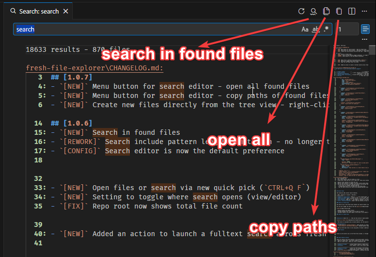
There are several new action buttons in the search editor results:
- Search in found files - new search scoped to the files you found
- Open all found files - opens all files as background tabs
- Copy paths - copies all absolute or relative paths from the results

## Use Cases

- **"I just cloned a large repo and don't know where to start."** Most files haven't been touched in the last 75 years. Fresh Files shows only what changed in the last 30 days, as a familiar tree. → [Time window](#time-window-based-file-explorer)
- **"I swear this file was here at some point."** Have you been drinking again? No: deleted files appear right where they used to be. → [Deleted files](#deleted-file-support)
- **"I deleted some files and need them back."** Right-click → *Resurrect*, several at once, no `git log --diff-filter=D` archaeology. → [Deleted files](#deleted-file-support)
- **"I committed and lost track of what I was working on."** Pending changes empty out on commit; with a "last 7 days" window your files stay in view, so small, frequent commits stop costing you the overview. → [Time window](#time-window-based-file-explorer)
- **"Someone reformatted the whole codebase and now every file is fresh."** Filter out that author, or (it was _you_, wasn't it?) that commit. → [Filtering](#filtering)
- **"Cool extension, but I was looking for a todo list app."** There just aren't enough of those. Fresh File Explorer is *also* a todo list. → [Pinned section](#pinned-section)
- **"Can it group my files by moon phase?"** [Yes.](#grouping-modes) It might be the *only* software that does.

## Extension Settings

Look under `freshfileexplorer.` to see all configurable settings.

## Performance

Unlike File Explorer, which just needs the files on your disk, Fresh File Explorer must load part of your git history to work. This is done in one streaming pass on startup, after which the results are cached. For the view to become usable, you only wait as long as your configured time window takes to load. The remaining time windows keep loading in the background, so that by the time you need them, they are ready. Reloads happen when switching branches or syncing changes.

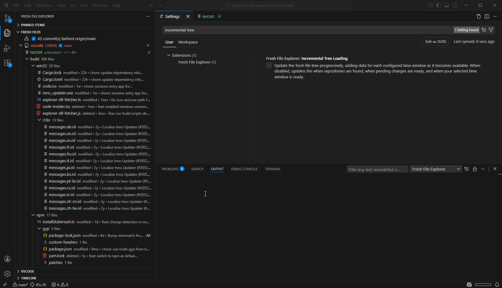

Not looking 5 years back in a large repo will go a long way in terms of performance. But you can. Also avoid configuring long time windows you never need - adds pointless startup overhead in the background.

If you mainly use the other features, set `freshFileExplorer.freshFileLoading` to `"manual"`: the history scan then waits for a Refresh (or a feature that needs it), while Branch Compare, the blame heatmap and the rest keep working.

## Security

I got some feedback around what is essentially an inherent problem with the trustworthiness of extensions in general. It's a valid concern and not one I can solve. 

All I can give you is some assurances:

- Fresh File Explorer contains no telemetry and does not make any web requests. It doesn't ask AI to do anything.
- The code is right here for you to audit. There are zero runtime dependencies.
- If you're worried about me getting hacked and malware being pushed through an update, you can disable automatic updates for any extension. You will lose out on new bugs and features, but you will always have the code you at some point chose to trust.
- The marketplace PATs are not stored on my machine. Github actions handle publishing to both marketplaces (vscode and openVSX). I don't publish to any other marketplace.

Potentially dangerous features: none, really. But for completeness' sake:
- Destructive operations: [discard pending changes](./src/commands/discardChangesCommand.ts) and [delete files](./src/commands/basicCommands.ts) (moved to trash). Both work on files you yourself selected and give you a warning.
- Rename uses `git mv` by default, or a plain filesystem rename if `freshFileExplorer.autoStageRename` is disabled. It will not overwrite existing files.
- It can create files if you choose to (via create or resurrect), but will never overwrite existing ones.
- When viewing deleted files (referred to as `exhume`), a copy is saved as a temp file in `%TEMP%\fresh-file-explorer` or `/tmp/fresh-file-explorer`. This is only for files you try to open. If you really want something gone, you'll have to delete it from there.
- Every git call passes its arguments as an array to one spawn wrapper, never through a shell, so filenames can't inject commands. A lint rule keeps it that way.
  
As well as some warnings:

- Don't install random extensions from the internet just because they look cool. They can do pretty much whatever on your computer. Except for mine, mine's good.
- A person who doesn't already know this is unlikely to bother reading this documentation.

## Contributing

If you find a bug or have an idea for a faster horse, open an issue.

For bug reports, it is extremely helpful if the problem is reproducible on a public repository.

## Comparison with GitLens

Fresh File Explorer is a focused **companion** to GitLens, not a replacement. It does the recent-changes navigation you reach for most of the day, and leaves the full SCM management to more comprehensive tools.

> A time-window view isn't *better* than a commit-centric one — but it's often handier. Your brain doesn't have git installed, but it usually knows what day it is.

| Feature | Fresh File Explorer | GitLens |
| --- | --- | --- |
| **Focus** | Recent-file navigation | Comprehensive git integration |
| **Learning curve** | Minimal | Significant |
| **Time-window view** (files from the last *N* days) | ✅ Built in | ❌ Reference-based only (branch / tag / commit) |
| **Multi-repo unified view** | ✅ Automatic across the workspace | ⚠️ Manual per-repo comparisons |
| **Deleted file restore** | ✅ One-click, shown inline in the tree | ✅ Via commit history (more steps) |
| **Blame** | ✅ Ambient heatmap — line-recency or branch-baseline coloring | ✅ Inline annotations + hover detail (richer) |
| **Line / function history** | ✅ Incl. pickaxe diff search | ✅ Detailed |
| **Commit graph** | ❌ Per-file history only | ✅ Visual graph |
| **Author / commit filtering** | ✅ Visual multi-select | ✅ Via search |
| **Price** | Free (will always accept your money) | Free (will sometimes demand your money) |
