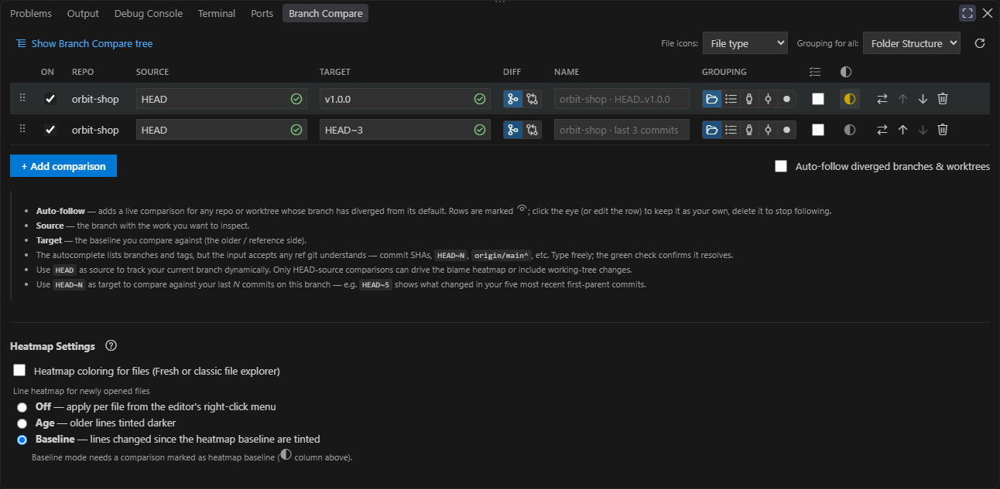
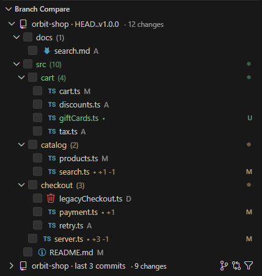
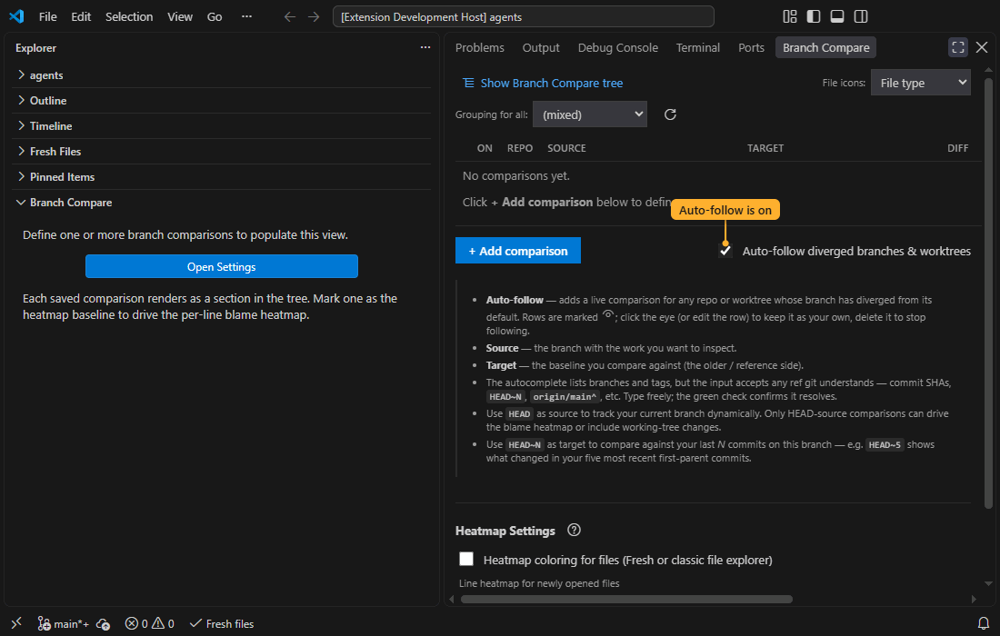

# Branch Compare

Saved branch-to-branch comparisons, each a live section in the Branch Compare tree. For the overview, see the [README](../README.md#branch-compare).

| Settings panel | Tree view |
|---|---|
|  |  |

## How it works

- Open the settings panel via the gear icon in the view title (or **Fresh File Explorer: Open Branch Compare Settings…**).
- Add a comparison: pick a repo, type a **source** ref (the branch with the work) and a **target** ref (the baseline you compare against).
- Click any file in the tree → opens a diff between the comparison's baseline (the merge-base) and the source ref.
- Per comparison you can also switch to a **full** diff against the target itself, hide files you've ticked as reviewed, or swap the two sides.
- File icons can show the file type or the kind of change (`freshFileExplorer.branchCompare.fileIcons`); `freshFileExplorer.branchCompare.workingTreeSide` picks which side of the diff your working tree is on.
- Right-click a deleted file → **Restore from Baseline** writes the baseline content back into the working tree as an unstaged change.
- Right-click a section or folder → **Open All Changes** queues every diff in the background.
- Right-click a file → **Open in External Diff Tool** opens it in your configured `git difftool` instead of the built-in diff editor.
- Right-click a section or folder → **Open All in External Diff Tool** does the same for every changed file at once, via `git difftool --dir-diff` — off by default (`freshFileExplorer.branchCompare.enableDirDiffTool`), see the gotchas below.

## What goes in source/target

- **Branches and tags** — `main`, `origin/release-q4`, `v1.2.0`. Autocomplete lists what's available.
- **`HEAD` as source** — tracks your current branch. Only HEAD-source comparisons include working-tree changes; uncommitted files appear with a `•` marker.
- **`HEAD~N` as target** — a quick "what did I change in my last N commits" view. It also works if your repo doesn't have N commits yet.
- **Any git-resolvable ref** — commit SHAs, `origin/main^`, etc. The green check next to the input confirms the ref resolves.

## Multiple comparisons

Define `vs main`, `vs release-q4` and `vs colleague-branch` at the same time — each gets its own section in the tree. Reorder with the up/down arrows or the drag handle in the settings panel; the tree follows the panel's order.

## Auto-follow diverged branches

Tick **Auto-follow diverged branches & worktrees** in the settings panel and comparisons appear on their own: every repo or worktree whose current branch has diverged from its default branch gets a live section. Stacked branches compare against their nearest ancestor branch, not `main`.

Auto-follows are ordinary comparisons — they show up in the settings panel like any other, marked with the 👁 icon. They're reconciled from live git, so switching a repo back to `main` or removing a worktree makes its section disappear on its own.

- **Delete** one (panel trash, or **Stop Following** on the tree section) to stop following it for the rest of the session — it stays gone until that branch changes (or you restart).
- **Keep** one — click its 👁 or rename it to adopt it as your own permanent comparison; auto-follow stops managing it from then on.

## Heatmap settings

Mark one HEAD-source comparison per repo (the heatmap icon in its row) as the blame heatmap's baseline. The heatmap then colors lines that changed between that comparison's target and HEAD.

The same panel hosts the file heatmap toggle and the line heatmap choice for newly opened files (Off / Age / Baseline). See [docs/heatmap.md](heatmap.md).

## Tips/gotchas

- **Empty diff** — if source is an ancestor of target, the diff is empty. The section says so ("No commits beyond main yet", or how far the target is ahead).
- **Merge commits** — when a `HEAD~N..HEAD` comparison sweeps in unexpected commits via merges, the tooltip shows both counts so the number of files in the tree makes sense.
- **Invalid refs** are hidden from the tree. The red X next to the input in the settings panel is the source of truth.
- **Duplicates** (same repo + source + target) are deduped in the tree and flagged with a warning in the settings panel.
- **External diff tool** — the single-file action works with any `diff.tool`. The multi-file (`--dir-diff`) action only works correctly with tools that support directory comparison (WinMerge, Meld, Beyond Compare); single-file tools like `code --diff` won't error, they'll just open an empty two-folder workspace with nothing diffed. Pick a directory-capable tool before enabling `enableDirDiffTool`.
