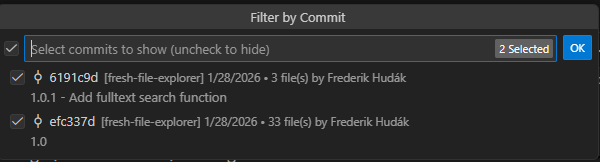
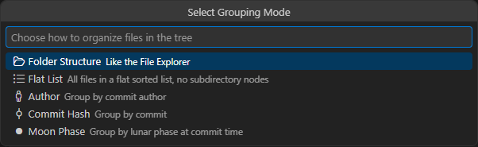
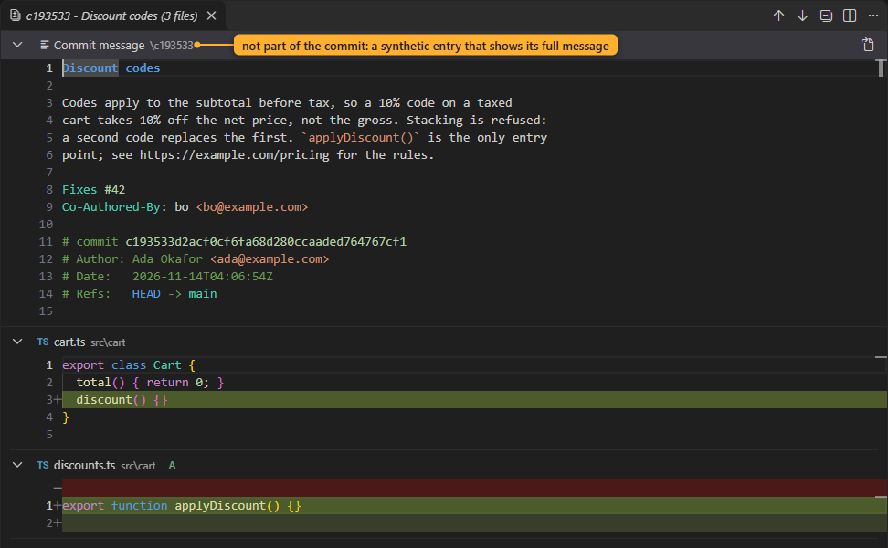
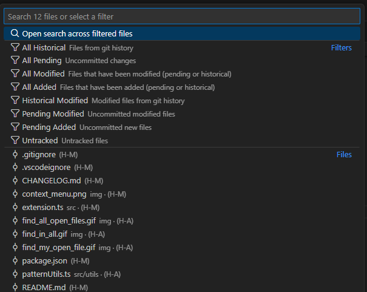
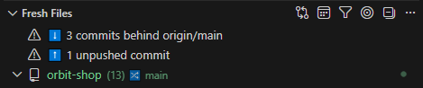

# Fresh Files

The Fresh Files view lists the files changed in your pending work and in a chosen time window of git history, as a tree. This page covers the tools that act on it. For the overview, see the [README](../README.md#fresh-files).

## Time windows

Switch between pending changes and files last modified in configurable time periods (`freshFileExplorer.timeWindows`). History for the longest window loads in one streaming pass and is cached, so switching to a shorter window needs no git call. See [Performance](../README.md#performance).

## Filtering

- **Filter by Author**: hide files from specific authors
- **Filter by Commit**: hide files from specific commits
- **Filter by AI Co-authorship**: show or hide changes from commits with an AI agent's `Co-authored-by` trailer (extend the recognized agents with `freshFileExplorer.aiCoAuthorEmails`)
- **Pathspec Filter**: restrict git log to specific files or directories using [git pathspecs](https://css-tricks.com/git-pathspecs-and-how-to-use-them/) (right-click on a repo folder)
- **Scope to Folder**: focus on a specific folder within a repo (right-click on any folder)
- **Generated files**: files your `.gitattributes` marks `linguist-generated` or `gitlab-generated` (lockfiles, generated code) are labelled "generated". **Show / Hide Generated Files** in the view's `...` menu hides them (`freshFileExplorer.hideGeneratedFiles`), in Branch Compare too.
- **Clear filters**

Author, commit and AI filters are temporary and reset when changing time windows.

## Grouping modes

- **Folder Structure** — the folder hierarchy
- **Flat list** — no nesting. `freshFileExplorer.flatList.labelStyle` picks whether the label is the full path or just the filename.
- **Author** — files grouped by who last modified them
- **Commit Hash** — one group per commit
- **Moon Phase** (`git blame moon`)

Uneven distribution of commits during the full moon can indicate werewolves among your contributors.

> Note: This is astronomy (hard science), not astrology (garbage). If you want to know if you will have merge conflicts with the changes made by a Sagittarius, you need to look elsewhere.

Relevant settings: `freshFileExplorer.defaultGroupingMode`, `freshFileExplorer.defaultSortOrder`.

## Open Commit

**Open Commit** (right-click a file or a commit row) opens every file the commit changed in one multi-diff editor. The first entry is the full commit message, with trailers, links, issue references and inline code highlighted, followed by the hash, author, date and branches.

The message entry shows the text once with `diffEditor.renderSideBySide` off (inline diffs), and on both sides with it on.

## Quick Open

**Fresh File Explorer: Quick Open** (`Ctrl+Q`, `F`) shows the files from the Fresh Files view in a quick pick. Type to filter by filename or path, then select a file to open it. It's like VS Code's `Ctrl+P`, limited to your fresh files, with a few actions on top:

- Respects the current time window, author and commit filters
- Filter options to refine the list
- A search option that runs a full-text search within these files
- Filter first, then search, to narrow the list:
  - First filter for example "pending modified"
  - A second quick pick shows only those files
  - The search action now searches only pending modified files

The quick open leaves out deleted files. Reach those from the tree.

### Code Telescope

The quick pick can open in the Code Telescope extension [(guichina.code-telescope)](https://marketplace.visualstudio.com/items?itemName=guichina.code-telescope) instead. It provides a better search experience but stays optional: install the extension and enable `freshFileExplorer.codeTelescopeIntegration`.

## Sync status

Shown at the top of the tree:

- When you are **behind/ahead** of the **remote** (you need to push/pull)
- When you are **behind/ahead** of the **base branch**, compared against its remote (e.g. `origin/main`), so new commits there show before you pull (you need to merge)

Both can be turned off individually (`freshFileExplorer.showCurrentBranchSync`, `freshFileExplorer.showBaseBranchSync`).
