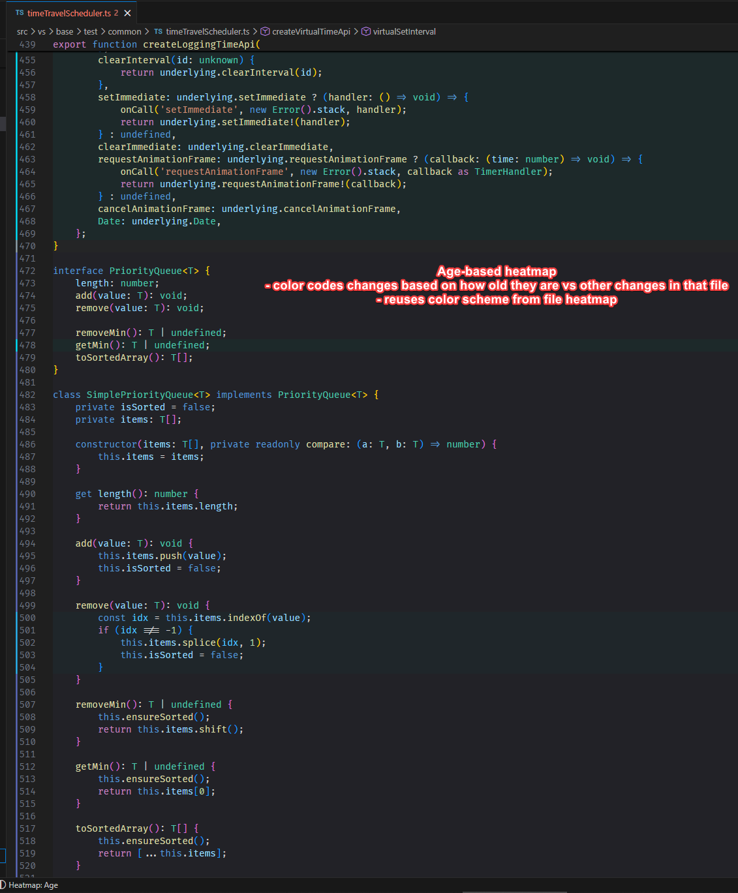
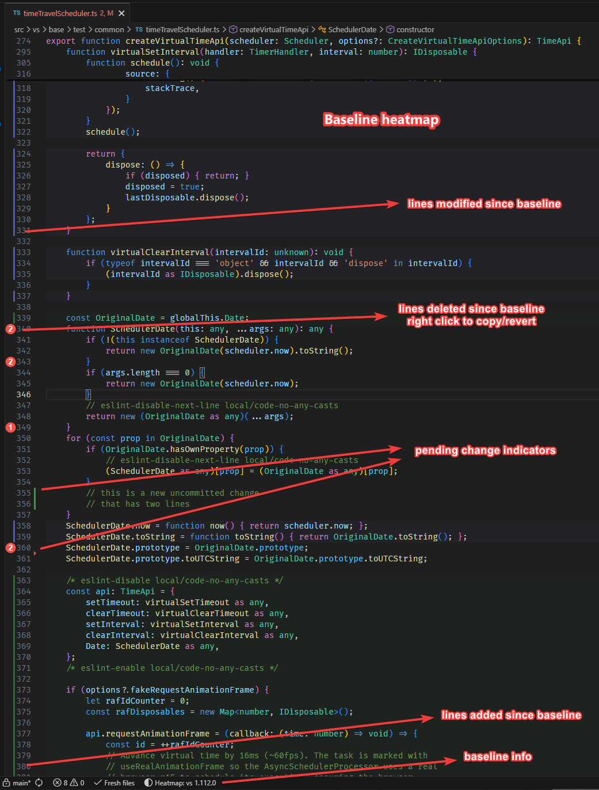

# Heatmaps

Two heatmaps show how recent the work in your repo is, at two scales.

## File heatmap

Colors files by when they were last changed, in the Fresh Files view, the File Explorer and editor tabs. Answers *"which files have been touched recently?"* at a glance.


Turn it on from the Fresh Files `…` menu, the *Toggle Heatmap Coloring* command, or the Branch Comparisons panel (`freshFileExplorer.heatmap.enabled`, off by default).

The colors follow your active time window: files inside it spread across `age1` (newest) to `age7`, and anything older than the window is `age8`, so "old but in range" stays distinct from "out of range". Switching the time window rescales the colors. Uncommitted files aren't colored; Git already marks them. With `freshFileLoading: "manual"`, colors appear after the first Refresh.

## Blame heatmap

Colors each line in the editor, as a gutter bar plus a faint background, by the commit that last changed it.

- *"Which lines in this function did I just change, and which have been around for a while?"*
- *"What did this branch actually touch in this file?"*
- *"What got deleted here since I branched off, and can I get it back?"*

### Modes

- **Age**: every line is colored by the age of its last commit, scaled to the file's own oldest line, so even a very old file uses the full range `age1` (newest) to `age7`. Fresh code stands out and old code fades; the who/when details are a hover away when you want them.

  

- **Baseline**: only lines from commits made since the baseline are colored. The baseline is the merge-base of your branch and a ref you pick (branch, tag, SHA or `HEAD~N`), so it means "since I branched off". Added lines get a green palette (`added*`), modified lines the age palette. Lines removed since the baseline show as red gutter badges with the number of deleted lines. Lines you haven't committed yet aren't colored in this mode.

  

A file that didn't exist at the baseline gets no colors, and the status bar shows `Heatmap: new file vs <ref>`.

### Where to control it

- **Status bar** (`Heatmap: …`): opens a picker with the modes, the baseline actions and the auto-apply toggle. Warnings such as "not in a git repo" show here too. Hide it with `freshFileExplorer.statusBar.heatmap`.
- **Right-click the line numbers** → *Blame Heatmap*: Off / Age / Baseline for this file, then *Change baseline…*, *Diff with saved baseline* and *Clear saved baseline* (once a baseline is set).
- **Branch Comparisons panel**: Off / Age / Baseline for newly opened files. Marking a comparison as heatmap baseline (the heatmap icon in its row) sets the baseline and switches to Baseline.
- **Right-click a deletion badge**: *Copy baseline lines* or *Restore from baseline*. Restoring saves the file.
- **Right-click in the editor**: *Diff with baseline…* opens a diff against the baseline (it asks for a ref the first time).

### Good to know

- The baseline is per repo and survives reloads. It's stored as a Branch Compare comparison: picking a baseline marks one, creating it if needed.
- If you switch to the branch you were comparing against, the baseline flips to the branch you just left, so the heatmap keeps showing "what changed relative to where you came from".
- New tabs get the current mode automatically. In Baseline mode, files in a repo without a baseline are skipped instead of asking for one.
- Files over `freshFileExplorer.blameHeatmap.maxFileLines` are skipped; the status bar says so, and shows a spinner while a large file is computed.
- After you type, the heatmap refreshes about 1.5 s later. It blames the saved file, so unsaved edits that add or remove lines shift the colors until you save.

## Settings

- `freshFileExplorer.heatmap.enabled` (default `false`): the file heatmap.
- `freshFileExplorer.blameHeatmap.autoApply` (default `true`): color newly opened files with the current mode. The Branch Comparisons panel's Off choice turns this off.
- `freshFileExplorer.blameHeatmap.backgroundOpacity` (default `0.1`): strength of the line background; 0.05–0.15 works best.
- `freshFileExplorer.blameHeatmap.maxFileLines` (default `1500`): skip larger files to keep `git blame` fast.
- `freshFileExplorer.statusBar.heatmap` (default `true`): show the status bar entry.

## Colors

The palette is 16 color IDs: `freshFileExplorer.heatmap.age1` … `age8` (shared by both heatmaps) and `freshFileExplorer.heatmap.added1` … `added8` (Baseline mode only). Each has light, dark and high-contrast defaults. Override any of them in `workbench.colorCustomizations`:

```jsonc
"workbench.colorCustomizations": {
    "freshFileExplorer.heatmap.age1": "#FF5500",
    "freshFileExplorer.heatmap.added1": "#00E676"
}
```

Theme-scoped sections (`"[Theme Name]": { … }`) work for the file heatmap, but the blame heatmap's gutter bar and background currently read only the top-level values.
