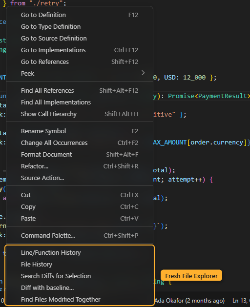
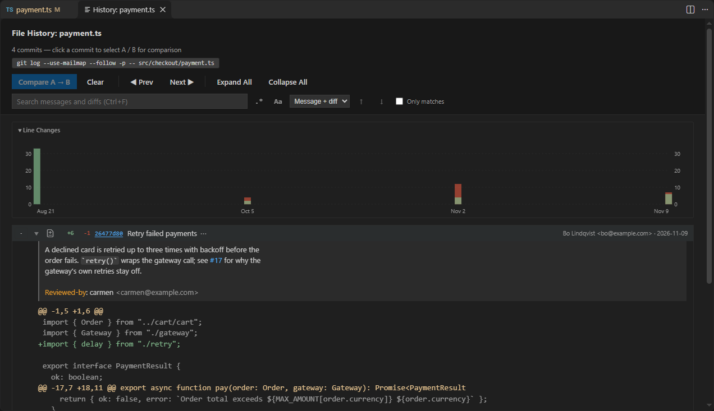
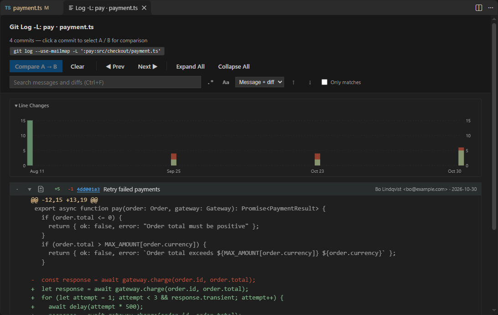
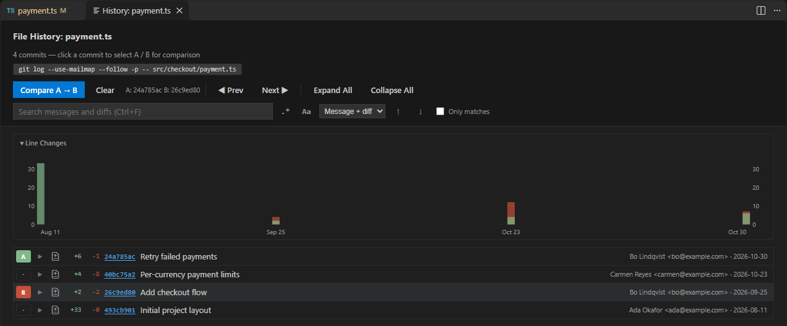
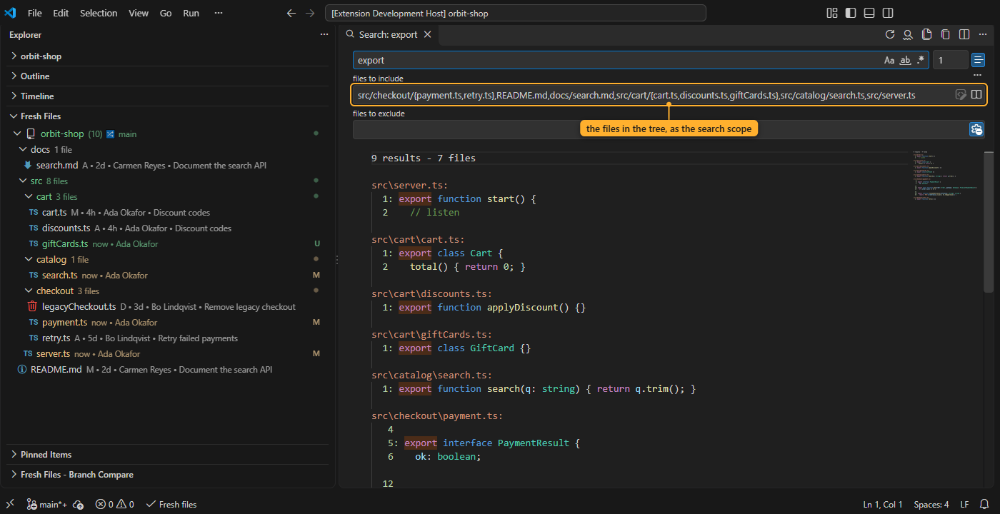
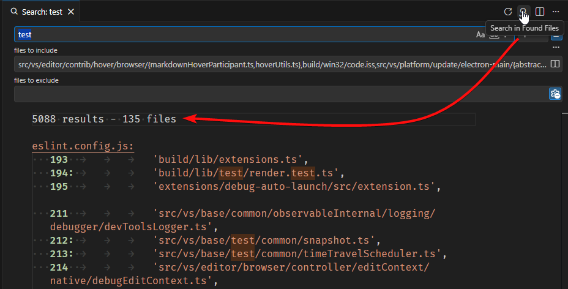
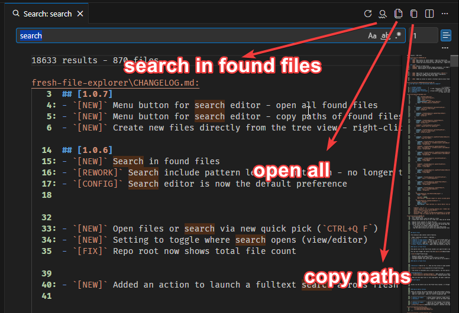

# Search & History

Git history searches and content searches scoped to the files you're working on. For the overview, see the [README](../README.md#search--history).

## Diff Search (pickaxe)

Answers "when was this string ever added or removed?" — the commits whose diff adds or removes a line matching a pattern (`git log -G`, the pickaxe).

Use the editor right-click menu (**Search Diffs for Selection**), or open the Diff Search panel for regex, case, include/exclude paths and a time limit. Results appear in a tree grouped by repo, commit and file; click a match to go to it.

## Line and Function History

Right-click in the editor → **Line/Function History**. Shows every commit that touched the selected lines or function, following renames (`git log -L`).

- **Single cursor / single line** — treated as a function name (the word under the cursor is the funcname pattern)
- **Multi-line selection** — treated as a line range

**A / B comparison:** mark any two commits as A and B, then click **Compare** to diff those two versions of the file.

## File History

From the right-click menu in the Fresh Files tree or the editor. Shows every commit that touched a file, following renames across the full repository history, including files outside the workspace.

**Line-changes chart** — a stacked bar chart at the top of the panel showing how many lines were added (green) and removed (red) in each commit:

- Hover over a bar to see the commit hash, message, author, date and exact line counts
- Click a bar to jump to that commit in the timeline below
- Up to 100 commits are shown at once; pan with the scrollbar or Shift + mouse wheel when there are more

## Search in Fresh Files

The search action in the Fresh Files `...` menu opens VS Code's search with all currently visible files filled into "files to include". It searches file *contents* on disk, only within the files you're working on, respecting your filters and time window. To search the tree itself, use `Ctrl+Alt+F`.

- Respects author and commit filters
- Leaves out deleted files (they're not on disk)
- Opens as a Search Editor by default (`freshFileExplorer.openSearchInEditor`)

You can also start it from [Quick Open](fresh-files.md#quick-open).

## Search in Found Files

**Problem:** "I want to find `b` in all files that contain `a`."

**Solution:** search for `a`, then use this action to open another search editor scoped to the files you found, then search for `b`. Chain it as many times as you want.

The action is available in search editors, not the search view, but you can open your search view as a search editor.

**Configuration:**

- `freshFileExplorer.openSearchInEditor`: open searches in a Search Editor tab instead of the Search view
- `freshFileExplorer.searchPatternMaxLength`: maximum pattern length per batch. Lower it if you hit command-line length limits on your OS, raise it if your searches are getting batched. The default (4000 characters) is conservative and can likely be much higher on Linux.

With many files or very long paths, VS Code's search (ripgrep) can hit OS command-line length limits. The file list is then split into batches, each opening as its own search editor.

## Search Editor Actions

Buttons added to search editor results:

- **Search in Found Files** — a new search scoped to the files you found
- **Open All Found Files** — opens them all as background tabs
- **Copy File Paths** — copies all absolute or relative paths from the results
